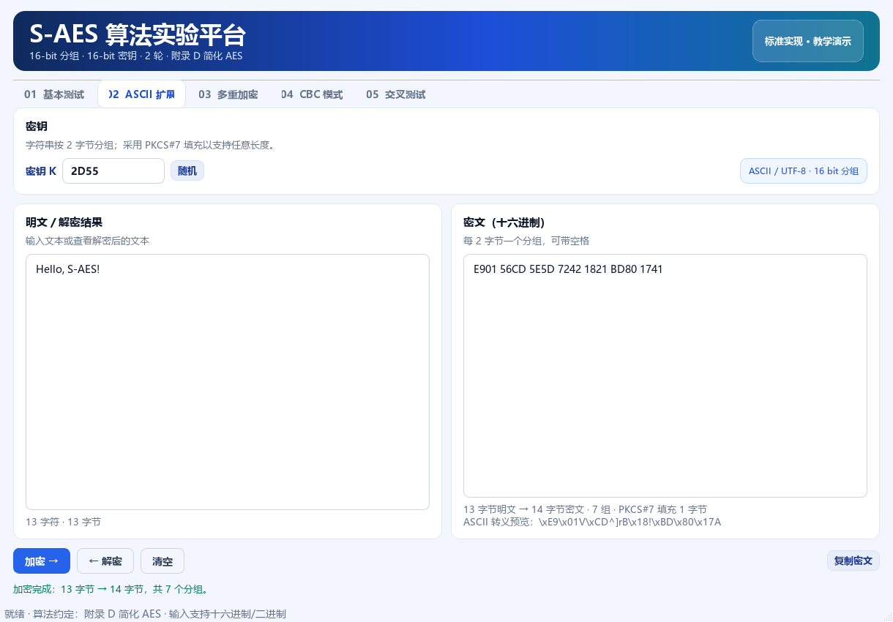
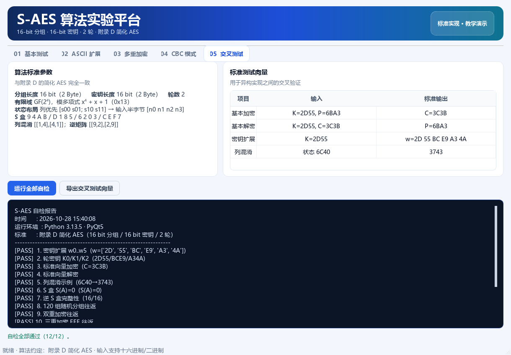

# S-AES 简化 AES 算法实验平台

> 信息安全导论 · 作业 2 · S-AES 算法实现  
> 依据《密码编码学与网络安全——原理与实践（第 8 版）》附录 D，使用 **Python + PyQt5** 完成。


本项目实现了作业要求的五个关卡：16 bit 分组加解密、标准交叉测试、ASCII 字符串扩展、双重/三重加密与中间相遇攻击、CBC 工作模式及密文篡改实验。算法核心与图形界面分离，配有 45 项自动化测试。配套实验报告见 [docs/实验报告.md](docs/实验报告.md)。

---

## 一、功能与作业要求对照

| 关卡 | 作业要求 | 本项目实现 |
|---|---|---|
| 第 1 关：基本测试 | 16 bit 数据 + 16 bit 密钥，输出 16 bit 密文；GUI 支持解密 | “基本测试”页：十六进制/二进制输入、加解密、随机密钥、结果二进制、逐轮状态轨迹 |
| 第 2 关：交叉测试 | 使用相同算法流程、S 盒、列混淆矩阵，异构程序结果一致 | 算法参数固定；提供标准向量、12 项 GUI 自检、45 项单元测试；可导出 JSON 交叉测试文件 |
| 第 3 关：扩展功能 | ASCII 字符串按 2 Byte 分组加解密 | “ASCII 扩展”页：UTF-8（兼容 ASCII）、PKCS#7 填充、密文十六进制与 ASCII 转义预览 |
| 第 4 关：多重加密 | 双重加密、中间相遇攻击、三重加密（二选一） | 32 bit 双重加密；完整 MITM 攻击；**两种**三重加密（32 bit EDE、48 bit EEE） |
| 第 5 关：工作模式 | CBC 加密长消息、生成并共享 IV、篡改密文后对比 | CBC 加解密、随机 IV、复制 IV+密文、按分组翻转比特/整组替换并逐组对比明文 |

---

## 二、运行方法

### 环境

- Windows / macOS / Linux
- Python 3.10 及以上（开发测试环境：Python 3.13.5）
- PyQt5 5.15 及以上（开发测试环境：PyQt5 5.15.11）

### 安装与启动

```bash
pip install -r requirements.txt
python main.py
```

Windows 也可以直接双击 `run.bat`。如果提示缺少 PyQt5，请先执行：

```bash
python -m pip install -r requirements.txt
```

### 运行测试

```bash
python -m unittest discover -s tests -v
```

测试覆盖核心变换、标准向量、填充、ASCII、双重/三重加解密、MITM、CBC 链接与篡改影响范围，共 45 项。

---

## 三、目录结构

```text
信息安全作业2/
├── main.py                     # 程序入口
├── run.bat                     # Windows 启动脚本
├── run_tests.bat               # Windows 测试脚本
├── requirements.txt
├── README.md
├── 附录D 简化AES.pdf           # 课程附录（原始资料）
├── s_aes/
│   ├── core.py                 # S-AES 分组算法：S 盒、密钥扩展、加解密、轨迹
│   ├── modes.py                # PKCS#7、字节串、双重/三重、CBC、篡改工具
│   ├── attacks.py              # 中间相遇攻击
│   ├── utils.py                # 十六进制/二进制解析、格式化
│   ├── gui.py                  # PyQt5 五个实验页
│   ├── theme.py                # 界面样式
│   └── __init__.py
├── tests/
│   ├── test_core.py
│   ├── test_modes.py
│   ├── test_attack.py
│   └── test_utils.py
└── docs/
    ├── 实验报告.md
    ├── screenshot_basic.png
    ├── screenshot_ascii.png
    ├── screenshot_multi.png
    ├── screenshot_cbc.png
    └── screenshot_selftest.png
```

---

## 四、算法约定（与附录 D 一致）

### 4.1 参数

| 参数 | 取值 |
|---|---|
| 分组长度 | 16 bit（2 Byte） |
| 密钥长度 | 16 bit（2 Byte） |
| 轮数 | 2 轮（另有初始轮密钥加） |
| 有限域 | GF(2⁴)，模多项式 x⁴ + x + 1（0x13） |
| 列混淆矩阵 | [[1, 4], [4, 1]] |
| 逆列混淆矩阵 | [[9, 2], [2, 9]] |

### 4.2 状态布局

16 bit 数据按**列优先**放入 2×2 半字节矩阵：

```text
[ s00  s01 ]     [ n0  n2 ]
[ s10  s11 ]  =  [ n1  n3 ]
```

其中 `n0` 是最高 4 bit，`n3` 是最低 4 bit。行移位交换第二行的 `s10` 与 `s11`；列混淆分别作用于两列 `(s00, s10)` 和 `(s01, s11)`。

### 4.3 S 盒

```text
行\列   0  1  2  3
  0     9  4  A  B
  1     D  1  8  5
  2     6  2  0  3
  3     C  E  F  7
```

逆 S 盒由正 S 盒反推得到，避免手抄错误：

```text
A 5 9 B 1 7 8 F 6 0 2 3 C 4 D E
```

### 4.4 密钥扩展

```text
w0 = K[15..8]          w1 = K[7..0]
w2 = w0 ⊕ g(w1, RCON1)
w3 = w2 ⊕ w1
w4 = w2 ⊕ g(w3, RCON2)
w5 = w4 ⊕ w3
g(w, RCON) = SubNib(RotNib(w)) ⊕ RCON
RCON1 = 0x80，RCON2 = 0x30
K0 = w0||w1，K1 = w2||w3，K2 = w4||w5
```

例如 `K = 2D55`：

```text
w = 2D 55 BC E9 A3 4A
K0 = 2D55，K1 = BCE9，K2 = A34A
```

### 4.5 加解密流程

```text
加密：AK2 ∘ SR ∘ NS ∘ AK1 ∘ MC ∘ SR ∘ NS ∘ AK0
解密：AK0 ∘ INS ∘ ISR ∘ IMC ∘ AK1 ∘ INS ∘ ISR ∘ AK2
```

最后一轮不含列混淆。`AK` 为轮密钥加，`NS` 为半字节代替，`SR` 为行移位，`MC` 为列混淆，前缀 `I` 表示逆变换。

---

## 五、各页面使用说明

### 5.1 第 1 关：基本测试

- 密钥、明文/密文均支持 **4 位十六进制**（如 `2D55`）或 **16 位二进制**（如 `0010 1101 0101 0101`，可带 `0x` / `0b` 前缀）。
- 点击“加密”或“解密”后，右侧显示从初始轮密钥加到第 2 轮的完整状态矩阵。
- 默认加载标准向量 `K=2D55, P=6BA3 → C=3C3B`，启动即可看到正确结果。

### 5.2 第 2 关：交叉测试

- “交叉测试”页列出算法参数与标准向量，点击“运行全部自检”执行 12 项检查。
- 点击“导出交叉测试向量”生成 JSON，包含 S 盒、逆 S 盒、密钥扩展、加密/解密和列混淆向量，可直接发给同组同学比对。
- 标准向量：`K=2D55, P=6BA3, C=3C3B`。

### 5.3 第 3 关：ASCII 扩展

- 输入文本先按 UTF-8 编码（纯 ASCII 文本完全兼容），再按 2 Byte 分组。
- 使用 **PKCS#7 填充**：奇数长度补 `0x01`，偶数长度补 `0x02 0x02`，因此任意长度都可还原。
- 密文以十六进制显示，并给出 ASCII 转义预览（密文很可能包含不可打印字符，故不直接按字符串显示）。



### 5.4 第 4 关：多重加密

- **双重加密**：`K = K1||K2`，`C = E_K2(E_K1(P))`，密钥 32 bit。
- **中间相遇攻击**：
  1. 对全部 2¹⁶ 个 `K1` 计算 `M = E_K1(P1)`，建立 `M → [K1]` 表；
  2. 对全部 2¹⁶ 个 `K2` 计算 `M' = D_K2(C1)`，查表得到候选 `(K1,K2)`；
  3. 用额外明密文对筛选候选。
- 实测候选数量（固定密钥 `1A2B3C4D`）：

  | 明密文对数 | 候选密钥数 | 说明 |
  |---:|---:|---|
  | 1 | 65,419 | 单组数据几乎无法唯一确定密钥 |
  | 2 | 4 | 仍可能有少量碰撞 |
  | 3 | 1 | 可唯一恢复，建议至少 3 组 |

  因此界面默认生成 3 组随机数据；攻击在后台线程执行，显示进度、耗时和候选列表，并自动核验隐藏的示例密钥。

- **三重加密**提供两种模式：
  - 32 bit 两密钥 EDE：`C = E_K1(D_K2(E_K1(P)))`；
  - 48 bit 三密钥 EEE：`C = E_K3(E_K2(E_K1(P)))`。


### 5.5 第 5 关：CBC 工作模式

- `C_i = E_K(P_i ⊕ C_{i-1})`，`C_0 = IV`；IV 为 16 bit，可随机生成，需与密文一起共享。
- 明文使用 UTF-8 + PKCS#7 填充；解密后自动去除并校验填充。
- “复制 IV + 密文”生成如下格式，便于发送给同组同学：

  ```text
  IV=6779
  C=EC5F 21F2 ...
  ```

- 篡改实验支持两种操作：
  - 翻转指定分组的 1 个 bit；
  - 把指定分组整体替换为 `0000`。

  解密后逐组显示原始明文与篡改后明文的十六进制差异，并给出影响分析。

  正确结论是：**被修改的 C_i 对应的 P_i 整体随机化；下一分组 P_{i+1} 因 XOR C_i 发生确定性变化；之后的分组不受影响。** 这正是 CBC 的误差传播特性，也说明 CBC 本身不提供完整性/认证。


---

## 六、标准测试向量

| 项目 | 输入 | 期望输出 |
|---|---|---|
| 基本加密 | `K=2D55, P=6BA3` | `C=3C3B` |
| 基本解密 | `K=2D55, C=3C3B` | `P=6BA3` |
| 密钥扩展 | `K=2D55` | `w=2D 55 BC E9 A3 4A`，`K2=A34A` |
| 列混淆 | 状态 `6C40`，即 `[6 4; C 0]` | `3743`，即 `[3 4; 7 3]` |
| S 盒 | `S(A)` | `0` |

运行验证：

```text
Ran 45 tests in 8.652s
OK
```

界面“交叉测试”页的 12 项自检也全部通过。



---

## 七、实现要点

### 7.1 模块化

- `core.py` 只处理单分组，不依赖界面，方便单元测试和交叉验证。
- `modes.py` 负责字节串、填充、多重加密、CBC 和篡改工具。
- `attacks.py` 只负责 MITM，通过 `progress` / `should_stop` 回调与界面解耦。
- `gui.py` 只做输入校验、结果展示和线程调度，不重复实现密码算法。

### 7.2 中间相遇攻击的性能

一次性建立 `2¹⁶` 项中间值表，再做 `2¹⁶` 次反向扫描。Python 实现在本机约 **3.3 秒**完成，内存占用约十余 MB，远优于 `2³²` 穷举。攻击后必须用至少 3 组明密文验证，单组数据会留下大量假候选。

### 7.3 输入校验与异常处理

- 所有十六进制/二进制输入都经过 `parse_bits` / `parse_hex_bytes` 校验，错误信息直接显示在对应页面，不弹模态框打断操作。
- 解密时校验 PKCS#7 填充；CBC 密钥、IV、密文长度不合法时给出明确提示。
- MITM 在 `QThread` 中运行，界面保持响应，可随时停止；关闭窗口时会请求线程退出。

### 7.4 代码规范

- 变量、函数、类使用有意义的 `snake_case` / `CamelCase` 命名；
- 关键变换和密码学细节有中文注释，简单代码不堆砌注释；
- 算法与界面分离，重复逻辑抽取为函数/类，例如 `Card`、`make_button`、`set_status`。

---

## 八、安全性与限制

1. **S-AES 是教学算法，不是安全加密算法**。16 bit 密钥只有 65,536 种，现代计算机可瞬间穷举；本项目仅用于理解 AES 的结构与工作模式。
2. 双重 S-AES 的 32 bit 密钥并不能提供 32 bit 安全强度，中间相遇攻击将工作量降到约 `2×2¹⁶`。
3. CBC 只提供机密性，不提供完整性。篡改实验表明，攻击者修改密文会导致对应明文随机化，但接收方无法可靠检测；实际系统应使用 MAC 或 AES-GCM 等认证加密。
4. 本项目使用 PKCS#7 填充，但未实现常量时间比较、密钥管理等生产级防护。
5. 密文以十六进制显示，是因为任意字节不一定能作为可打印 ASCII 字符显示；这是显示层的选择，不影响算法本身按字节处理。

---

## 九、三人小组分工建议

| 成员 | 建议负责内容 |
|---|---|
| A | 核心算法：S 盒、密钥扩展、行移位、列混淆、加解密轨迹；标准向量核对 |
| B | 多重加密与 MITM：双重/三重模式、攻击表构建与候选筛选、性能测试 |
| C | GUI 与测试：五个页面交互、CBC 篡改实验、45 项单元测试、README/报告与交叉测试 |

交叉测试时，建议各自用自己的程序对同一组 `(K,P)` 加密，再互相对方解密，并交换导出的 JSON 向量；不要只比对界面截图。

---

## 十、参考资料

- William Stallings.《密码编码学与网络安全——原理与实践（第 8 版）》附录 D：简化 AES。
- 课程资料《附录D 简化AES.pdf》（本目录下）。
- 标准向量核对：`2D55 / 6BA3 → 3C3B`，密钥扩展 `2D55 → 2D 55 BC E9 A3 4A`。
