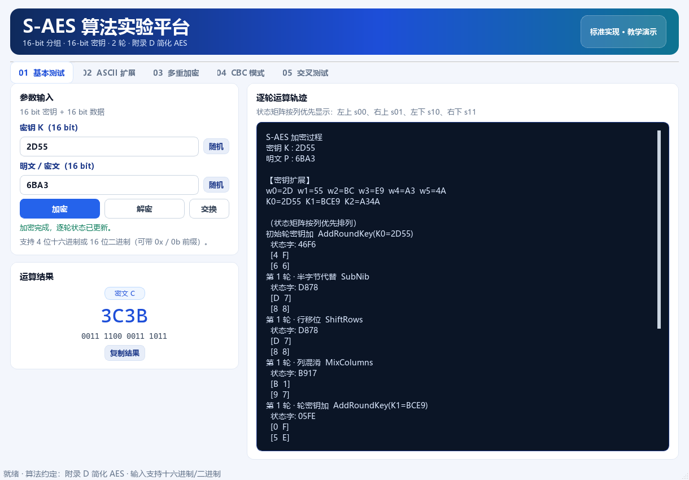
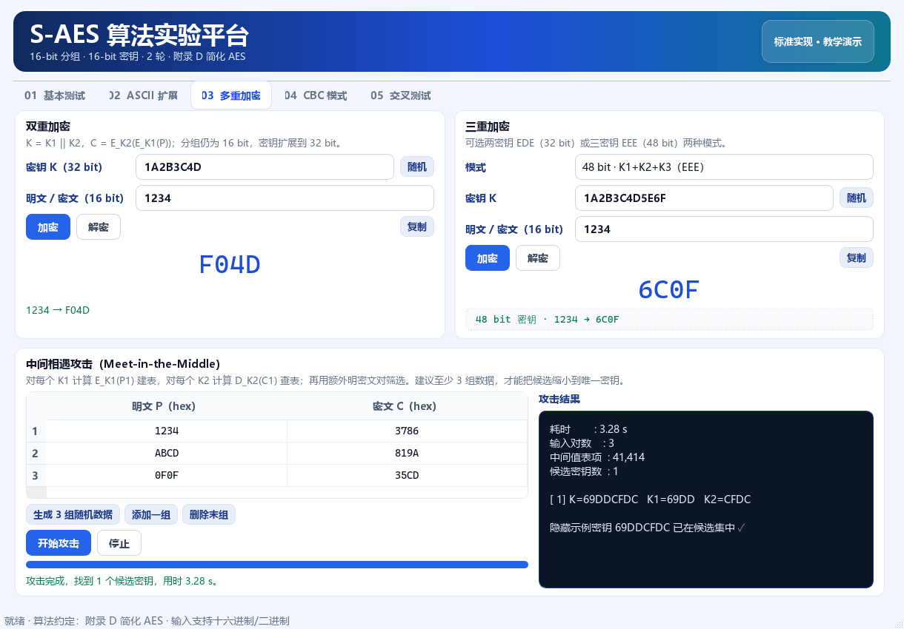
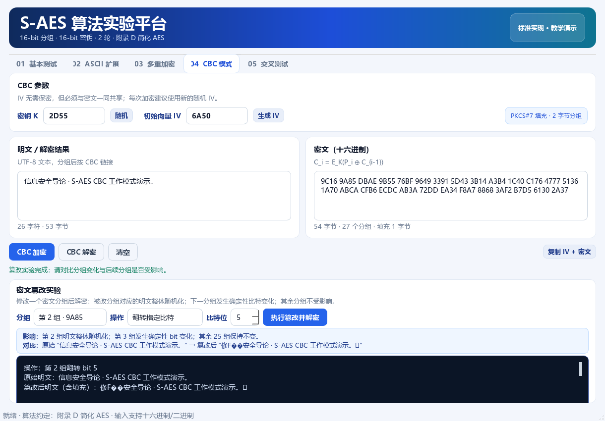

# S-AES 简化 AES 算法实验报告

**课程**：信息安全导论  
**实验**：作业 2 · S-AES 算法实现  
**实现语言**：Python 3.13 + PyQt5  
**算法依据**：《密码编码学与网络安全——原理与实践（第 8 版）》附录 D

---

## 一、实验目的

1. 理解 AES 的基本结构，包括分组、密钥扩展、S 盒、行移位、列混淆和轮密钥加。
2. 按附录 D 实现 16 bit 分组、16 bit 密钥、2 轮的 S-AES 加解密算法。
3. 使用 PyQt5 编写图形界面，支持用户输入、加解密和逐轮状态观察。
4. 扩展实现 ASCII 字符串、双重/三重加密、中间相遇攻击和 CBC 工作模式。
5. 通过标准向量与自动化测试验证算法实现的正确性和跨平台一致性。

---

## 二、算法原理

### 2.1 参数与状态

S-AES 分组为 16 bit，密钥为 16 bit，共 2 轮。状态按列优先放入 2×2 半字节矩阵：

```text
[ s00  s01 ]     [ n0  n2 ]
[ s10  s11 ]  =  [ n1  n3 ]
```

`n0` 为最高 4 bit。所有运算在 GF(2⁴) 上进行，模多项式为 `x⁴ + x + 1`（0x13）。

### 2.2 基本变换

- **半字节代替（NS）**：对每个半字节查 S 盒。
- **行移位（SR）**：第一行不变，第二行循环左移一个半字节。
- **列混淆（MC）**：每个列左乘矩阵 `[[1,4],[4,1]]`。
- **轮密钥加（AK）**：状态与 16 bit 轮密钥逐位异或。
- **逆变换**：逆 S 盒、逆行移位（与行移位相同）、逆列混淆矩阵 `[[9,2],[2,9]]`。

S 盒：

```text
9 4 A B
D 1 8 5
6 2 0 3
C E F 7
```

### 2.3 密钥扩展

```text
w2 = w0 ⊕ RCON1 ⊕ SubNib(RotNib(w1))
w3 = w2 ⊕ w1
w4 = w2 ⊕ RCON2 ⊕ SubNib(RotNib(w3))
w5 = w4 ⊕ w3
```

其中 `RCON1=0x80`，`RCON2=0x30`，轮密钥为 `K0=w0||w1`、`K1=w2||w3`、`K2=w4||w5`。

### 2.4 加解密流程

```text
加密：AK2 ∘ SR ∘ NS ∘ AK1 ∘ MC ∘ SR ∘ NS ∘ AK0
解密：AK0 ∘ INS ∘ ISR ∘ IMC ∘ AK1 ∘ INS ∘ ISR ∘ AK2
```

最后一轮不含列混淆。

---

## 三、程序实现

### 3.1 模块划分

| 模块 | 职责 |
|---|---|
| `s_aes/core.py` | S 盒、GF(2⁴)、密钥扩展、单分组加解密、逐轮轨迹 |
| `s_aes/modes.py` | PKCS#7 填充、字节串、双重/三重加密、CBC、篡改工具 |
| `s_aes/attacks.py` | 中间相遇攻击，支持进度和停止回调 |
| `s_aes/utils.py` | 十六进制/二进制解析与格式化 |
| `s_aes/gui.py` | 五个实验页面的 PyQt5 界面 |
| `tests/` | 45 项自动化测试 |

核心算法不依赖 Qt，可单独导入和测试；界面只负责输入校验、结果展示和线程调度。

### 3.2 图形界面

主界面包含五个标签页：

1. **基本测试**：16 bit 加解密，显示逐轮状态矩阵。
2. **ASCII 扩展**：文本按 UTF-8 编码、2 Byte 分组，PKCS#7 填充。
3. **多重加密**：双重加密、MITM 攻击、32/48 bit 三重加密。
4. **CBC 模式**：随机 IV、长消息加解密、密文篡改对比。
5. **交叉测试**：标准参数、测试向量、自检、JSON 导出。



---

## 四、测试结果

### 4.1 标准向量

| 项目 | 输入 | 输出 | 结果 |
|---|---|---|---|
| 加密 | K=2D55, P=6BA3 | C=3C3B | 通过 |
| 解密 | K=2D55, C=3C3B | P=6BA3 | 通过 |
| 密钥扩展 | K=2D55 | w=2D 55 BC E9 A3 4A，K2=A34A | 通过 |
| 列混淆 | 状态 6C40 | 3743 | 通过 |

### 4.2 自动化测试

执行命令：

```bash
python -m unittest discover -s tests -v
```

结果：

```text
Ran 45 tests in 8.652s
OK
```

测试内容包括：

- S 盒与逆 S 盒完整性；
- 密钥扩展与 4 个标准/教材向量；
- 500 组随机分组加解密往返；
- PKCS#7 填充与异常填充检测；
- ASCII 与二进制字节串加解密；
- 双重加密、32 bit EDE 三重加密、48 bit EEE 三重加密；
- CBC 链接关系、随机 IV、篡改影响范围；
- MITM 密钥恢复、候选数量、进度与停止；
- 十六进制/二进制输入解析。

界面“交叉测试”页的 12 项自检也全部通过。

---

## 五、多重加密与中间相遇攻击

### 5.1 双重加密

采用 `K = K1||K2`，加密为：

```text
C = E_K2(E_K1(P))
```

分组仍为 16 bit，但密钥长度为 32 bit。

### 5.2 中间相遇攻击

攻击步骤：

1. 对全部 `2^16` 个 `K1` 计算 `M = E_K1(P1)`，建立 `M → [K1]` 表；
2. 对全部 `2^16` 个 `K2` 计算 `M' = D_K2(C1)`，查表得到候选 `(K1,K2)`；
3. 用额外明密文对筛选。

实测（密钥 `1A2B3C4D`）：

| 明密文对数 | 候选密钥数 | 用时 |
|---:|---:|---:|
| 1 | 65,419 | 约 1.8 s |
| 2 | 4 | 约 3.2 s |
| 3 | 1 | 约 3.3 s |

单组明密文几乎不能唯一确定密钥，因为对任意 `(P,C)` 都存在大量 32 bit 密钥对；至少 3 组数据才能把候选缩小到唯一值。攻击将 `2^32` 穷举降为约 `2 × 2^16` 次分组运算。



### 5.3 三重加密

实现两种模式：

- 32 bit 两密钥 EDE：`C = E_K1(D_K2(E_K1(P)))`；
- 48 bit 三密钥 EEE：`C = E_K3(E_K2(E_K1(P)))`。

两种模式均通过往返测试。

---

## 六、CBC 工作模式与篡改实验

### 6.1 CBC 加密

```text
C_i = E_K(P_i ⊕ C_{i-1})，C_0 = IV
```

IV 为 16 bit，可随机生成，需与密文一同共享。明文使用 UTF-8 编码和 PKCS#7 填充。

### 6.2 篡改实验

取 `K=2D55`、`IV=1234`、明文 `0123456789`，加密得到 6 个分组：

```text
33DF 8123 1C2D 4D98 9AEB 4E66
```

翻转第 2 个密文分组的 bit 5：

```text
33DF 8103 1C2D 4D98 9AEB 4E66
```

解密后的明文分组变化：

| 分组 | 原始明文 | 篡改后明文 | 变化 |
|---:|---|---|---|
| 1 | 3031 | 3031 | 无 |
| 2 | 3233 | 3A53 | 整体随机化 |
| 3 | 3435 | 3415 | bit 5 翻转 |
| 4 | 3637 | 3637 | 无 |
| 5 | 3839 | 3839 | 无 |
| 6 | 0202 | 0202 | 无（填充） |

结论：

- 被修改的 `C_i` 对应明文 `P_i` 整体随机化；
- 下一分组 `P_{i+1}` 因 XOR `C_i` 发生确定性变化；
- 之后的分组不受影响；
- CBC 只提供机密性，不提供完整性，实际系统应配合 MAC 或使用认证加密。



---

## 七、代码规范与工程实践

1. **命名**：使用 `snake_case` 命名函数和变量，`CamelCase` 命名类；避免无意义的单字母变量。
2. **注释**：对 S 盒、密钥扩展、列混淆、CBC 链接和 MITM 建表等关键步骤添加中文注释，简单赋值不重复注释。
3. **模块化**：算法、模式、攻击、界面、工具分层；重复的按钮/卡片/状态提示抽取为函数或类。
4. **异常处理**：输入错误、填充错误、长度错误、越界错误均给出明确提示，不使程序崩溃。
5. **线程**：MITM 在 `QThread` 中执行，支持进度显示和停止，避免界面卡死。
6. **可测试性**：核心算法不依赖 GUI，测试可以直接导入并运行。

---

## 八、总结

本实验完成了 S-AES 的完整实现，并通过标准向量、随机往返和界面自检验证了正确性。扩展部分覆盖了 ASCII 字符串、双重/三重加密、中间相遇攻击和 CBC 工作模式；其中 MITM 实验直观展示了“双重加密不等于两倍密钥安全强度”，CBC 篡改实验展示了分组链接模式的错误传播特性以及缺少完整性保护的风险。

S-AES 仅用于教学，16 bit 密钥可被瞬间穷举；实际系统应使用 AES 等安全算法，并采用带认证的工作模式。

---

## 九、小组分工（建议填写）

| 成员 | 主要工作 |
|---|---|
| 成员 A | 核心算法、S 盒/密钥扩展/列混淆、标准向量核对 |
| 成员 B | 双重/三重加密、MITM、CBC 与篡改实验 |
| 成员 C | PyQt5 界面、自动化测试、文档与交叉测试 |
